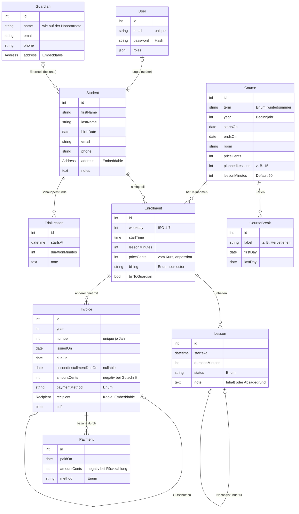

# Phase 2: Datenmodell (Entwurf)

Stand: 2026-11-12, zweiter Entwurf. Die Antworten der ersten Fragenrunde sind eingearbeitet (Abschnitt 7). Neue Fragen
stehen in Abschnitt 8, Antworten bitte wieder direkt dahinter. Erst nach der Freigabe folgen Entities und Migrationen.

Grundlage: `anforderungen.md` (Abschnitte A–C), Honorarnoten-Muster `claude_references/HN16_GU_WiSe_2026_Springer.pdf`,
Sonjas bisherige Anwesenheitsliste `claude_references/Anwesenheit_Inhalt_2026_ProRe.numbers`.
Versionen laut `composer.lock`: Doctrine ORM 3.7.6, DBAL 4.5.0, PostgreSQL 18.

Getroffene Entscheidungen (2026-11-12):

- Admin-Oberfläche mit eigenen Controllern, Forms und Votern (kein EasyAdmin).
- Echte Daten trägt Sonja oder Mike über die Admin-Masken in Produktion ein. Lokal und in Tests gibt es erfundene
  Daten aus Fixtures (Abschnitt 6).
- Zeitzone `Europe/Vienna`, Entity-Namen wie unten, Unterricht zu zweit ohne eigenes Schema, eine Honorarnote mit
  Ratenoption, Gutschrift als Honorarnote mit negativem Betrag, PDF einmal erzeugen und ablegen (Abschnitt 7).

## 1. Überblick



Dazu kommen Einstellungen (Abschnitt 3.9), die keine Beziehungen zu den übrigen Tabellen haben.

**Änderungen gegenüber dem ersten Entwurf:** `CourseBreak` (Ferien) und `TrialLesson` (Schnupperstunde) sind neu,
Kursbeginn und -ende werden gespeichert (für das Erzeugen der Einheiten), Lesson hängt immer an einer Teilnahme und
hat keine eigene Beziehung zur Schülerin mehr, Guardian hat ein Namensfeld statt Vor- und Nachname, Enrollment
bekommt `billToGuardian`, Invoice bekommt Fälligkeiten, das PDF und den Verweis für Gutschriften.

## 2. Grundsätze

Diese Regeln gelten für alle Entities. Die Begründung steht jeweils dabei, weil hier die typischen Fehler passieren.

**Geldbeträge als ganze Cent (`int`), nie `float`.** Ein `float` kann 0,1 nicht exakt darstellen, Summen werden dann
um Bruchteile falsch (0,1 + 0,2 ≠ 0,3). Doctrines Typ `decimal` wäre exakt, kommt in PHP aber als `string` an
(`vendor/doctrine/dbal/src/Types/DecimalType.php`: „Type that maps an SQL DECIMAL to a PHP string“), man rechnet
dann mit `bcmath`. Ganze Cent sind einfacher: € 495,– wird als `49500` gespeichert, umgerechnet wird nur bei der
Anzeige (Twig-Filter) und im Formular (Symfonys `MoneyType` mit `divisor: 100`).

**Zeitzone Europe/Vienna (entschieden).** PHP läuft im Container derzeit mit `date.timezone = UTC`
(`frankenphp/conf.d/10-app.ini`). Doctrines `datetime_immutable` speichert in PostgreSQL `timestamp` **ohne**
Zeitzone, also genau die Uhrzeit, die PHP liefert. Mit UTC stünde eine Einheit um 16:00 als 15:00 (Winter) bzw.
14:00 (Sommer) in der Datenbank, und jede Anzeige müsste umrechnen. Deshalb `date.timezone = Europe/Vienna`; die
Umstellung kommt mit der ersten Entity.

**Immer `*_immutable`-Typen** (`date_immutable`, `datetime_immutable`, `time_immutable`). Bei veränderbaren
`DateTime`-Objekten erkennt Doctrine eine Änderung wie `$lesson->getStartsAt()->modify('+1 day')` nicht, weil die
Referenz gleich bleibt. Die Änderung wird dann stillschweigend nicht gespeichert.

**Enums als PHP-Backed-Enums** (`enum LessonStatus: string`), in der Spalte als `string` mit `enumType`. Lesbar in der
Datenbank, typsicher in PHP, Übersetzung über `labelKey()` wie bei `App\Inquiry\Occasion`.

**IDs als `int` mit `IDENTITY`.** UUIDs bräuchte man, wenn IDs in URLs nicht erratbar sein sollen oder Daten aus
mehreren Quellen zusammenkommen. Der Admin-Bereich ist ohnehin nur für angemeldete Rollen zugänglich, und die
Prüfung „darf diese Person das sehen?“ übernimmt der Voter, nicht die Unerratbarkeit der ID.

**Beziehungen standardmäßig `LAZY`, keine `cascade: ['remove']`.** Löschen soll bewusst passieren (Abschnitt 5).

## 3. Entities im Einzelnen

### 3.1 User

Login für Mike (`ROLE_SUPER_ADMIN`), Sonja (`ROLE_ADMIN`) und später Schüler:innen (`ROLE_STUDENT`). Rollen als
JSON-Array, wie es `make:user` erzeugt. Details zu Rollen und Votern folgen in `rollen.md`.

**Warum User und Student getrennt?** Eine Schülerin existiert zuerst ohne Login (Sonja legt sie an). Ein Login kommt
vielleicht später dazu, vielleicht nie. Würde Student von User erben (Doctrine-Vererbung), bräuchte jeder Student
E-Mail und Passwort, und Mike/Sonja wären keine Students. Deshalb eine optionale 1:1-Beziehung.

**Owning Side:** Bei Doctrine speichert immer nur eine Seite die Fremdschlüssel-Spalte, die „Owning Side“. Nur
Änderungen an dieser Seite werden gespeichert. Setzt man nur `$user->setStudent($student)` auf der inversen Seite,
passiert in der Datenbank nichts. Vorschlag: `Student.user` ist Owning Side (Spalte `student.user_id`, nullable,
unique), weil die Beziehung vom Student aus entsteht.

### 3.2 Student und Guardian

- **Geburtsdatum statt Alter:** Das Alter ändert sich, ein gespeichertes „15“ ist nächstes Jahr falsch. Minderjährig
  wird daraus berechnet (`isMinorOn(date)`), etwa als Vorschlag für `billToGuardian` (Abschnitt 3.4).
- **Guardian als eigene Entity (n:1), eine Person je Schüler:in** (Antwort 4): Geschwister teilen sich einen
  Elternteil, die Adresse steht dann nur einmal in der Datenbank.
- **Ein Namensfeld statt Vor- und Nachname:** Auf der Muster-Honorarnote stehen beide Eltern („Anna und Peter
  Muster“). Ein freies Feld `name` deckt das ab, ohne einen zweiten Guardian zu brauchen. Es ist genau der Text, der auf
  der Honorarnote steht.
- **Adresse als Embeddable `Address`** (Straße, PLZ, Ort, Land), siehe 3.2.1.

#### 3.2.1 Was ist ein Embeddable?

Ein Embeddable ist eine PHP-Klasse, die mehrere Felder zu einem Wert bündelt, aber **keine eigene Tabelle und keine
ID** hat. Ihre Spalten landen in der Tabelle der Entity, in der sie eingebettet ist:

```php
#[ORM\Embeddable]
final class Address
{
    #[ORM\Column(length: 255)]
    private string $street;

    #[ORM\Column(length: 10)]
    private string $postalCode;
    // city, country …
}

#[ORM\Entity]
class Student
{
    #[ORM\Embedded(class: Address::class)]
    private Address $address;
}
```

In der Tabelle `student` entstehen daraus die Spalten `address_street`, `address_postal_code` usw. Das Präfix ist
standardmäßig der Name der Eigenschaft (`columnPrefix` am Attribut `Embedded`, siehe
`vendor/doctrine/orm/src/Mapping/Embedded.php` und `ClassMetadata::inlineEmbeddable()`).

**Warum für die Adresse?** Student, Guardian und der Empfänger der Honorarnote brauchen dieselbe Adresse. Mit einem
Embeddable gibt es die Felder, ihre Validierung (`#[Assert\…]`) und das Formular (`AddressType`) nur einmal, und in
Twig reicht `student.address.city`. Eine eigene Tabelle `address` mit Fremdschlüssel wäre die Alternative. Die lohnt
sich, wenn eine Adresse eigenständig existiert und von mehreren Stellen geteilt wird. Hier gehört sie fest zu ihrer
Person, ein Join wäre nur Aufwand.

**Fallstricke:**

- Ein Embeddable ist in Doctrine **nie `null`**. Auch wenn alle Spalten leer sind, legt Doctrine beim Laden ein
  Objekt an (`vendor/doctrine/orm/src/Mapping/PropertyAccessors/EmbeddablePropertyAccessor.php`, `setValue()`). Eine
  „fehlende Adresse“ ist also ein Address-Objekt mit leeren Feldern; die Spalten müssen dann `nullable` sein.
- Ein Embeddable kann keine Beziehungen zu Entities haben, nur einfache Spalten.

Dasselbe Prinzip nutzt `Recipient` in der Honorarnote (Abschnitt 3.7).

### 3.3 Course und CourseBreak

Ein Kurs ist das, was bisher „Semester“ hieß, z. B. Wintersemester 2026/27 im Raum 1.12.

- **`term` + `year` statt freiem Text:** Der Dateiname der Honorarnote braucht `WiSe`/`SoSe` und das Jahr
  (`HN16_GU_WiSe_2026_Springer.pdf`), der Text auf der Honorarnote „Wintersemester 2026/27“. Beides wird aus `term` und
  `year` (Beginnjahr) erzeugt.
- **`startsOn` und `endsOn` werden jetzt gespeichert.** Im ersten Entwurf ergaben sie sich aus den Einheiten. Weil die
  App die Einheiten jetzt selbst erzeugt (Abschnitt 3.5), braucht sie Beginn und Ende als Vorgabe.
- **`plannedLessons` (z. B. 15):** Grundlage für die Nachholregel und die Anzeige „14 von 15“ im Raster.
- **`priceCents` und `lessonMinutes`** sind Vorgaben für neue Teilnahmen.
- **CourseBreak (Ferien, Feiertage):** Zeitraum mit Bezeichnung, gilt für den ganzen Kurs. In Sonjas Liste sind Ferien
  eine ganze Zeile („HERBSTFERIEN“), also für alle gleich. Ein einzelner Feiertag ist ein Zeitraum mit gleichem
  Anfang und Ende. In diesen Zeiträumen erzeugt die App keine Einheiten.

### 3.4 Enrollment (Kursteilnahme)

- **Eindeutig je Kurs und Schüler:in** (Unique-Constraint auf `course_id, student_id`): niemand nimmt zweimal am
  selben Kurs teil.
- **Zeitfenster als `weekday` (1–7) + `startTime` (`time_immutable`)** statt Text „Freitag 15:00“. Nur so lässt sich
  der Stundenplan sortieren und lassen sich Termine erzeugen.
- **`priceCents` als Kopie vom Kurs, änderbar:** Ermäßigung, Unterricht zu zweit oder späterer Einstieg betreffen
  nur diese eine Teilnahme. Ändert Sonja danach den Kurspreis, bleiben bestehende Teilnahmen unverändert.
- **`billing`** als Enum: vorerst nur `semester` (eine Honorarnote, zahlbar gesamt oder in zwei Raten). Einzel-
  abrechnung oder 10er-Block kommen als weitere Werte dazu, wenn Sonja sie braucht. Die Logik wird ein
  Strategy-Service je Wert, das Enum ist nur die Auswahl. Ein Enum-Wert mehr ist keine Schemaänderung, weil die Spalte
  ein `string` ist.
- **`billToGuardian`** (Antwort 3): Sonja entscheidet je Teilnahme, ob die Honorarnote an den Elternteil geht.
  Vorbelegt mit „ja“, wenn ein Guardian eingetragen und die Schülerin bei Kursbeginn minderjährig ist.
- **Unterricht zu zweit** (Antwort 2): zwei Teilnahmen mit je eigener Einheit zur selben Zeit, Vermerk in der Notiz.
  Kein eigenes Schema.

### 3.5 Lesson (Einheit)

- **Gehört immer zu einer Teilnahme** (`enrollment` nicht nullable). Die Schülerin ergibt sich über
  `lesson.enrollment.student`. Damit ist die Redundanz aus dem ersten Entwurf weg, weil Schnupperstunden eine eigene
  Entity bekommen (Abschnitt 3.6).
- **Einheiten werden erzeugt** (Antwort 5): Beim Anlegen einer Teilnahme erzeugt die App für jede Woche von
  `course.startsOn` bis `course.endsOn` eine Einheit mit Status `planned` im Zeitfenster der Teilnahme, außer in den
  Ferien. Trägt Sonja später Ferien ein, entfernt die App die geplanten Einheiten in diesem Zeitraum. Bereits
  gehaltene oder abgesagte bleiben und werden als Konflikt angezeigt.
- **`startsAt` + `durationMinutes`:** Verschiebungen und Doppelstunden ändern nur diese eine Einheit, nicht das
  Zeitfenster der Teilnahme.
- **`status`** als Enum: `planned`, `held`, `cancelled_by_student` (verfällt), `cancelled_by_teacher` (ggf. nachholen).
  Wer abgesagt hat, ist eine fachliche Kategorie, kein Login.
- **`note`** (vorher `summary`): ein Textfeld für den Inhalt („Runaway“, „Tauflieder“) oder den Absagegrund („krank“).
  Was gemeint ist, sagt der Status. So sieht es auch in Sonjas Liste aus: eine Zelle je Schülerin und Woche.
- **Nachholstunde als Selbstreferenz** `makeUpFor` (Lesson → Lesson, nullable): Die Nachholstunde zeigt auf die
  ausgefallene Einheit. So bleibt nachvollziehbar, welche Absage nachgeholt wurde.
- **Nachholregel:** Gezählt werden alle Einheiten der Teilnahme außer `cancelled_by_teacher`. Liegt die Zahl unter
  `plannedLessons − Schwellwert`, schlägt die App eine Nachholstunde vor. Der Schwellwert ist eine Einstellung.

### 3.6 TrialLesson (Schnupperstunde)

**Empfehlung: eigene Entity** (deine Einschätzung). Gründe:

- Lesson bleibt einfach: immer mit Teilnahme, keine Validierung „`student` = `enrollment.student`“, kein Fall „Einheit
  ohne Kurs“ in Nachholregel, Zählung und Raster.
- Eine Schnupperstunde hat andere Regeln: keine Nachholstunde, kein Semesterpreis, keine Zählung gegen
  `plannedLessons`.
- Der Preis dafür: Ansichten, die alle Termine zeigen (Dashboard „nächste Einheiten“), lesen aus zwei Tabellen. Das ist
  eine zweite Abfrage, keine Komplikation im Modell.

Felder: Schüler:in, `startsAt`, `durationMinutes`, `note`. Wer zur Schnupperstunde kommt, wird als Student angelegt
(mit so wenigen Daten wie nötig). Bleibt die Person nicht, löscht Sonja sie wieder (Abschnitt 5). Ob und wie eine
Schnupperstunde abgerechnet wird, ist Frage 8.2.

### 3.7 Invoice (Honorarnote)

- **Eine Honorarnote je Teilnahme und Semester, mit Ratenoption** (Antwort 6, Muster): Betrag, „zahlbar gesamt bis
  `dueOn`“ oder „zwei Raten, 1. bis `dueOn`, 2. bis `secondInstallmentDueOn`“. Ohne zweites Datum fällt der
  Ratenteil auf dem PDF weg. Die Ratenbeträge werden berechnet (Hälfte, bei ungeraden Cent bekommt die erste Rate
  den Cent mehr), nicht gespeichert.
- **Nummer je Jahr:** `year` + `number`, Unique-Constraint auf beide. Die nächste Nummer ist `MAX(number) + 1` des
  Jahres. **Fallstrick:** Legen zwei Anfragen gleichzeitig eine Honorarnote an, bekommen beide dieselbe Nummer. Der
  Unique-Constraint verhindert das Speichern der zweiten, die App versucht es dann erneut.
- **Welches Jahr?** (Antwort 7) Das Muster ist am 07.11.2026 ausgestellt und bis 13.11. bzw. 31.12. zahlbar, also
  **vor** dem Geldfluss. Es gibt deshalb zwei Daten mit zwei Aufgaben:
  - **Nummer und Datum der Honorarnote** = Ausstellungsdatum (`issuedOn`): „16/2026“, weil am 07.11.2026 ausgestellt.
  - **Einnahmen fürs Finanzamt** = Datum der Zahlung (`Payment.paidOn`). Bei der Einnahmen-Ausgaben-Rechnung zählt,
    wann das Geld eingeht. Zahlt jemand die zweite Rate erst im Jänner 2027, gehört sie zu den Einnahmen 2027, obwohl
    die Honorarnote „/2026“ heißt. Das genaue Prinzip (Zufluss, § 19 EStG) prüfe ich vor dem Export in der Primärquelle.
  - **Jahr im Dateinamen** (`WiSe_2026`) = Kursjahr (`course.year`), wie bisher.
  Siehe Frage 8.1.
- **Empfänger als Kopie (Embeddable `Recipient`: Name + Adresse), nicht als Verweis:** Eine Honorarnote ist ein
  Beleg und darf sich nicht ändern, wenn später die Adresse korrigiert wird. Name, Adresse und Betrag werden beim
  Erstellen kopiert („Snapshot“). Der Verweis auf die Teilnahme bleibt für die Zuordnung.
- **Unveränderlich nach dem Erstellen.** Korrekturen laufen über einen neuen Beleg.
- **Gutschrift** (Antwort 8): neue Honorarnote mit negativem Betrag und eigener Nummer, Verweis `credits` auf die
  ursprüngliche. Die Rückzahlung selbst ist eine Zahlung mit negativem Betrag an der Gutschrift; so stimmt die
  Einnahmensumme des Jahres.
- **PDF einmal erzeugen und ablegen** (Antwort 9). Wo? Vorschlag: **in der Datenbank** (`bytea`, ca. 50 KB je
  Honorarnote, bei sechs Schüler:innen und zwei Semestern rund 0,6 MB im Jahr). Dann sichert ein Datenbank-Backup
  alles auf einmal, und es gibt keinen Fall „Datensatz da, Datei weg“. Alternative: Datei in einem Docker-Volume
  (`var/invoices/`). Das ist üblicher bei vielen oder großen Dateien, braucht aber ein zweites Backup. Bei dieser Menge
  spricht nichts gegen die Datenbank. Spalte in einer eigenen Tabelle `invoice_pdf` (1:1), damit Listen von
  Honorarnoten das PDF nicht mitladen.
- **Download:** einzeln und je Kurs als ZIP. Die Zahlung wirkt sich nicht auf die Verfügbarkeit aus: Die Honorarnote
  ist die Zahlungsaufforderung und entsteht vorher. Der Hinweis beim ZIP lautet stattdessen: „3 Teilnahmen haben noch
  keine Honorarnote“, mit Link zum Erstellen.
- **Absenderdaten** (Name, Titel, Adresse, Bankverbindung, Hinweis zur Umsatzsteuerbefreiung, Ort, Unterschrift)
  kommen aus den Einstellungen. Ein Snapshot dafür ist nicht nötig, weil das abgelegte PDF sie enthält.

### 3.8 Payment

Eine Honorarnote kann in mehreren Teilen bezahlt werden (Raten, Teilzahlung). Bezahlt ist sie, wenn die Summe der
Zahlungen den Betrag erreicht. Der Status wird berechnet, nicht gespeichert, damit er nie veraltet. „Mit einem Klick
bezahlt“ legt eine Zahlung über den offenen Restbetrag mit dem heutigen Datum an. `method`: bar oder Überweisung.

### 3.9 Einstellungen und Startseite

- **`Settings` als Entity mit genau einer Zeile und typisierten Spalten:** aktives Theme (`App\Theme\Theme`),
  Standarddauer einer Einheit (50), Schwellwert für Nachholstunden, Absenderdaten der Honorarnote (Name, Titel,
  Adresse als `Address`, IBAN, BIC, Bank, Ort, Text zur Umsatzsteuerbefreiung) und die Unterschrift als Bild.
  Alternative: Schlüssel-Wert-Tabelle. Die braucht keine Migration für neue Einstellungen, verliert aber Typen und
  Validierung. `App\Theme\SiteSettings` liest dann hier statt aus `config/services.yaml`.
- **`HomeSlide`:** Bild, Ausschnitt (`position`), Reihenfolge, aktiv. Dazu gehört ein Bild-Upload samt WebP-Erzeugung
  am Server. Den würde ich als eigenen Schritt planen (Speicherplatz, RAM beim Umrechnen, Backups der Bilder).

### Später (nicht Teil dieses Entwurfs)

Repertoireliste (Song: Titel, Interpret, Kategorie, Tonart) und Preisschätzung fürs Booking, kleines CMS für Texte.

## 4. Arbeitsansicht: Kursraster

Antwort 5 ist vor allem eine Anforderung an die Oberfläche. Das Modell oben ist darauf ausgerichtet; die Umsetzung
plane ich mit dem Admin-Bereich im Detail. Die Idee, angelehnt an Sonjas Liste:

```
Wintersemester 2026/27        13:40 Schülerin A   14:40 Schülerin B   15:30 Schülerin C   …
                              11 von 15           12 von 15           12 von 15
KW 41  Fr 09.10.             ✓ Runaway           ✓ Flowers           ✓ Animal
KW 42  Fr 16.10.             ✓ Auf uns           ✗ krank             ○ geplant
KW 44  HERBSTFERIEN ───────────────────────────────────────────────────────────
KW 45  Fr 06.11.             ○                   ○                   ○
```

- Zeilen sind Kalenderwochen, Spalten die Teilnahmen sortiert nach Wochentag und Uhrzeit, Zellen die Einheiten.
- Klick in eine Zelle öffnet ein kleines Eingabefeld direkt dort: Notiz tippen, Status mit einem Klick (gehalten,
  abgesagt von Schülerin, abgesagt von mir), Enter speichert, Tab springt zur nächsten Zelle. Kein Seitenwechsel.
- Klick auf eine Zeile: „Ferien/Feiertag“ setzt einen CourseBreak für diese Woche, die geplanten Einheiten
  verschwinden.
- Nachholstunden stehen in ihrer Woche in der Zelle der Schülerin, mit Hinweis auf die ausgefallene Einheit.
- Kopfzeile je Spalte mit Zählung „11 von 15“ und Warnung, wenn die Nachholregel greift.

Technisch: Speichern per JavaScript ohne Neuladen. Ob mit Stimulus + `fetch`, Turbo Frames oder Live Components, ist
die offene Entscheidung „Symfony UX“ im Projektstand und fällt bei der Planung des Admin-Bereichs.

## 5. Löschen und Aufbewahrung

- **Keine Kaskaden beim Löschen.** Eine Schülerin mit Honorarnoten darf nicht gelöscht werden können, sonst wären die
  Belege weg. Die Datenbank verhindert das über den Fremdschlüssel (`ON DELETE RESTRICT`, Doctrines Standard).
- **Aufbewahrungspflicht für Belege:** Honorarnoten müssen mehrere Jahre aufbewahrt werden. Die genaue Frist prüfe ich
  vor der Umsetzung in der Primärquelle (BAO). Nach Ablauf: Schüler:innen-Daten löschen bzw. anonymisieren.
- **Schnupperstunden ohne Fortsetzung:** Daten löschen, sobald klar ist, dass die Person nicht bleibt (keine
  Honorarnote → nichts aufzubewahren, sofern Frage 8.2 nichts anderes ergibt).
- **DSGVO:** Personenbezogene Daten nur im Admin-Bereich sichtbar, nie in Logs. Backups der Datenbank, **bevor** die
  ersten echten Daten eingetragen werden (Projektstand). Schüler:innen und Eltern müssen außerdem informiert werden,
  welche Daten Sonja wie verarbeitet (Art. 13 DSGVO). Das ist eine eigene Information, z. B. bei der Anmeldung, nicht
  die Datenschutzerklärung der Website.

## 6. Daten für Entwicklung und Tests

Entschieden: **Fixtures mit Zenstruck Foundry** (Factories, Faker für erfundene Namen und Adressen), nur als
`require-dev`, also nicht im Prod-Image.

- Lokal: `doctrine:fixtures:load` füllt die Datenbank mit einem plausiblen Kurs, Teilnahmen, Einheiten, Honorarnoten.
- Tests: Dieselben Factories erzeugen in jedem Test genau die Daten, die er braucht (z. B. „eine Teilnahme mit zwei
  abgesagten Einheiten“).

Verworfene Alternativen:

- **Prod-Dump lokal einspielen:** Echte Daten von Schüler:innen und Kindern auf dem Entwicklungsrechner, in jeder
  lokalen Datenbank und jedem Test. Nur für die gezielte Fehlersuche, danach löschen. (Backups auf dem Mac sind etwas
  anderes: verschlüsselt abgelegt, nicht in eine laufende App geladen.)
- **Schülerdaten als Migration:** Migrationen sind für das Schema. Daten darin würden mit dem Repo versioniert, also
  echte Personendaten auf GitHub.
- **CSV-Import:** Bei sechs Schüler:innen ohne bestehende Liste (Antwort 1) ist das Eintippen über die Masken
  schneller, und es testet gleich die Masken.

## 7. Fragen, Runde 1 (beantwortet 2026-11-12)

1. Wie viele Schüler:innen hat Sonja ungefähr, und gibt es eine bestehende Liste (Excel o. Ä.)? - 6, Excelliste gibt es noch keine (ich muss erst nachsehen, wo die Daten der Schüler:innen notiert sind)
2. Unterricht zu zweit: Zwei Teilnahmen mit je eigener Einheit zur selben Zeit, oder eine Einheit mit zwei
   Schüler:innen? Das zweite bräuchte eine n:m-Beziehung zwischen Lesson und Student. - Das ist eine Ausnahme (bisher nur Einzelstunden), also nehmen wir hier die Variante, die ohne Schemaänderung auskommt (zwei Teilnahmen mit je eigener Einheit zur selben Zeit, Vermerk im Lesson.summary zB wäre dann ausreichend)
3. Geht die Honorarnote bei Minderjährigen immer an den Elternteil, oder entscheidet Sonja je Teilnahme? - entscheidet Sonja, auch wenn es voraussichtlich immer der Elternteil sein wird. Aber es ist theoretisch möglich, dass zb eine 16-jährige Schülerin selbst für die Stunde bezahlt.
4. Braucht es pro Schüler:in mehrere Elternteile (z. B. getrennte Eltern, Rechnung an einen)? - Nein, eine Person reicht
5. Einheiten erzeugen: Soll die App aus Zeitfenster und Kursbeginn die wöchentlichen Termine vorschlagen, wobei Sonja
   Ferientage abwählt? Oder trägt sie jede Einheit selbst ein? - Sonja trägt bisher gehaltene Stunden, deren Inhalt (stichwortartig) und Ausfallgrund pro Stunde in eine Excelliste ein (siehe claude_references/Anwesenheit_Inhalt_2026_ProRe.numbers). Wenn sie diesen Workflow in die app übertragen kann, ist das kein Problem, es sollten nur die Stunden einfach zugänglich sein, damit das Eintragen keinen großen Aufwand darstellt. Damit meine ich: Eine Navigation Stundenplan->Stunde->Inhalt eintragen->zweimal zurück->nächste Stunde wäre zu aufwändig. Können wir hier eine view erzeugen, wo Sonja direkt in den Stundenplan klicken kann, der bereits die geplanten Stunden enthält, und per JavaScript dann direkt Inhalt, Ausfall, etc. eintragen und auch den Tag wegen Ferientag abwählen kann? Es geht darum, dass das alles in einem möglichst kompakten und hübsch designten Workflow integriert sein muss und keine mühsame Navigation durch ihren admin-Bereich bedingt.
   → Ja: Einheiten werden erzeugt (3.5), Ferien als CourseBreak (3.3), Kursraster (Abschnitt 4).
6. Raten (`installments`): Zwei Honorarnoten (je Rate eine) oder eine Honorarnote mit zwei Zahlungen? - eine HN, siehe Muster HN16_GU_WiSe_2026_Springer
   → 3.7: Fälligkeiten an der Honorarnote, Raten als Zahlungen.
7. Jahr in Nummer und Dateiname: Honorarnote 16 „des Jahres 2026“. Ist das das Ausstellungsjahr oder das Kursjahr? Bei
   einem Wintersemester 2026, das im Februar 2027 abgerechnet wird, fallen beide auseinander. - HN trägt immer das Datum des Geldflusses, also ist das das Datum, wann Sonja die Zahlung einträgt, relevant. Ist das so ausreichend definiert?
   → Noch nicht ganz, siehe 3.7 „Welches Jahr?“ und Frage 8.1.
8. Preiskorrektur (Rückerstattung bei Krankheit): neue Honorarnote mit negativem Betrag (Gutschrift), Storno und neue
   Honorarnote, oder nur eine Zahlung mit negativem Betrag (Rückzahlung)? Ggf. mit Sonjas Steuerberatung klären. - neue HN mit negativem Betrag (Gutschrift)
9. PDF der Honorarnote: bei jedem Abruf neu erzeugen (immer aus den gespeicherten Daten, kein Speicherplatz) oder
   einmal erzeugen und ablegen (exakt das, was verschickt wurde)? Mein Vorschlag: einmal erzeugen und ablegen. - einmalig erzeugen und ablegen. sowohl Batch-download aller HN eines Kurses als zip als auch Download einzelner HN für Sonja ermöglichen. Beim Batchdownload sollte Sonja darauf hingewiesen werden, wenn aufgrund fehlender Zahlung noch nicht alle HN im Download enthalten sind. Oder wirkt sich die Zahlung nicht auf die Verfügbarkeit der HN aus?
   → Die Zahlung wirkt sich nicht aus, siehe 3.7 „Download“.
10. Zeitzone `Europe/Vienna` für PHP (Abschnitt 2): einverstanden? - ja
11. Namen der Entities (`Enrollment`, `Lesson`, `Guardian`, `Invoice`): passt das, oder lieber andere? - passt

Zusätzliche Fragen von Mike:

- Was ist ein "Embeddable" und wie ist das mit der Adresse genau gemeint? → Abschnitt 3.2.1
- Mir kommt die Schnupperstunde als eigene kleine Entity sauberer vor - was ist deine Empfehlung? → Abschnitt 3.6,
  einverstanden
- Dashboard und Export der Einnahmen → als Todos in Abschnitt 9

## 8. Offene Fragen, Runde 2

Antworten bitte direkt dahinter.

1. **Jahr der Honorarnote:** Die Muster-Honorarnote ist am 07.11.2026 ausgestellt und erst danach zahlbar. Mein
   Vorschlag: Nummer „/2026“ und Datum = Ausstellungsdatum; für die Einnahmen eines Jahres zählt das Zahlungsdatum
   (3.7). Passt das, oder meinst du, dass Sonja die Honorarnote erst nach Eingang der Zahlung ausstellt (dann wäre
   „zahlbar bis“ auf dem Muster überflüssig)?
2. **Schnupperstunden:** Kosten sie etwas, und wenn ja: mit Honorarnote (dann braucht Invoice einen Bezug zur
   Schnupperstunde statt nur zur Teilnahme) oder bar ohne Beleg?
3. **Unterrichtstage:** Unterrichtet Sonja in einem Kurs nur an einem Wochentag (in der Liste alle am Freitag)? Dann
   können die Zeilen im Raster Daten statt Kalenderwochen sein. Das Modell ist davon nicht betroffen.
4. **Absenderdaten:** Titel „Bakk.phil.“ wie im Muster, auch mit den neuen Abschlüssen (IGP, Konzertfach)? Kommt
   die Unterschrift als Bild auf das PDF wie bisher?
5. **Späterer Einstieg:** Kommt es vor, dass jemand mitten im Semester einsteigt? Dann braucht Enrollment ein
   eigenes Startdatum, ab dem Einheiten erzeugt werden; sonst löscht Sonja die früheren im Raster.

## 9. Todos für den Admin-Bereich (nach dem Datenmodell)

- **Kursraster** (Abschnitt 4) als Hauptansicht für Sonja.
- **Dashboard:** Übersicht aller Schüler:innen, nächste Einheiten (inkl. Schnupperstunden), bisher entfallene und
  gehaltene Einheiten, offene Honorarnoten, Einnahmen je Kurs und Jahr.
- **Export der Einnahmen je Jahr** für die Einnahmen-Ausgaben-Rechnung (Basis: `Payment.paidOn`, CSV oder PDF; Format
  mit Sonja bzw. Steuerberatung klären).
- **PDF der Honorarnote** (Bibliothek wählen: läuft im PHP-Container, kein zusätzlicher Container wegen RAM) und
  ZIP-Download je Kurs.
- **Datenschutz-Information** für Schüler:innen und Eltern (Art. 13 DSGVO).
- **Backups** der Datenbank vor den ersten echten Daten.
